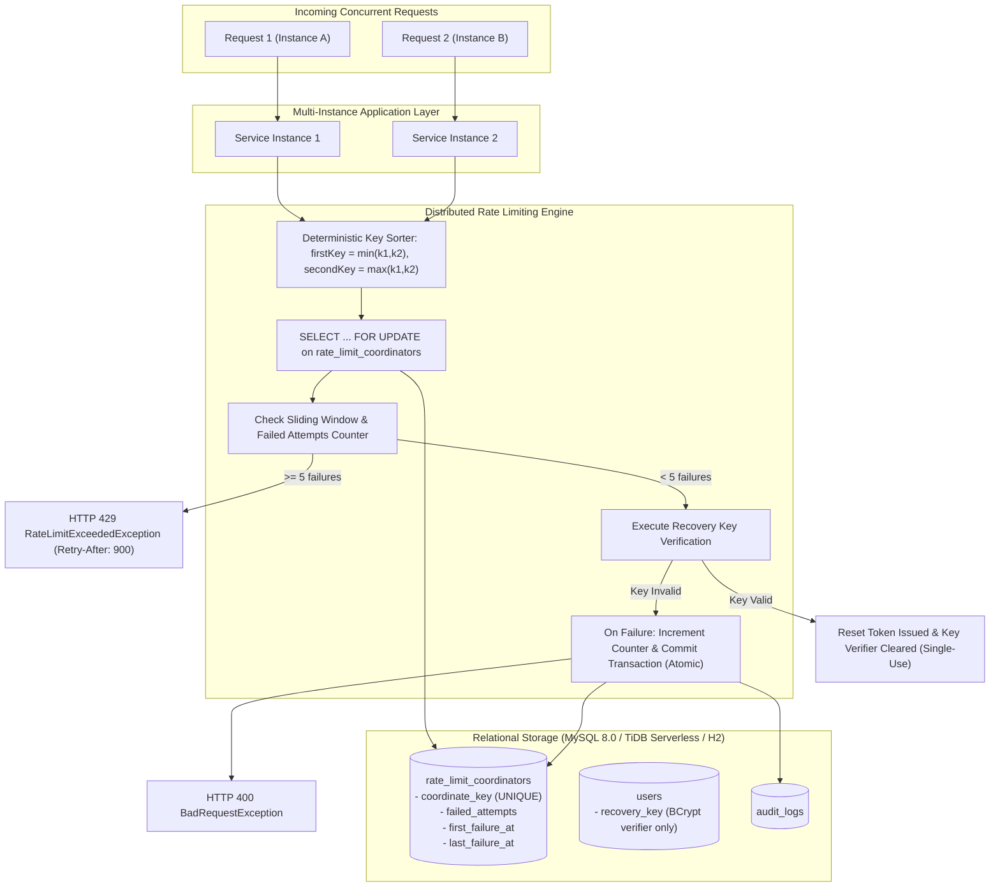

# SareeKart Step 4.10 — Emergency Recovery-Key Security Remediation Final Report

**Date:** October 16, 2026
**Status:** Verification Complete — Final Corrections Verified Across Distributed Instances
**Repository Working Directory:** `/Users/chaitanyachaitu/Downloads/SareeKart-main`
**Git Base Commit:** `d831b27` (`security(auth): harden emergency recovery-key lifecycle`)
**Budget & Cloud Spend:** Strict ₹0 Cloud Expenditure (Zero External Paid Dependencies)

---

## Executive Summary

This report documents the completed implementation and empirical verification for **SareeKart Step 4.10 — Emergency Recovery-Key Security Remediation (`SEC-01`, `SEC-02`, `SEC-03`)**, addressing:
1. **Durable Multi-Instance Database Coordination (`SEC-03`)**: Replaced process-local in-memory lock stripes with database row-level locking (`SELECT ... FOR UPDATE`) over dedicated coordination records in table `rate_limit_coordinators` (`V34` migration). Eliminates multi-instance race conditions across containerized or auto-scaled application instances.
2. **Deterministic Deadlock-Free Ordering**: Coordinate keys are sorted lexicographically prior to lock acquisition, mathematically eliminating database deadlock risks when locking multiple dimensions (source IP and target account).
3. **Privacy-Preserving SHA-256 Coordinate Keys**: Raw IP addresses and user emails are never stored in the coordination table; keys use pseudonymous one-way SHA-256 hashes (`ip:<sha256>`, `acct:<sha256>`).
4. **Explicit Accounting Policy**: Only failed recovery verification attempts consume the 5-attempt/15-minute sliding window budget. Successful recovery key verification issues a reset token without penalizing the user. Attempt 6 onwards is blocked with HTTP 429 and `Retry-After: 900`.
5. **Permanent Legacy Verifier Invalidation (`SEC-01` / `SEC-02`)**: Cleared legacy plaintext and static demo keys via data-only migration `V33`. In addition, runtime fail-safe invalidation in `UserServiceImpl` immediately purges non-BCrypt verifiers from persistent storage upon access (`reloadedUser.getRecoveryKeyHash() == null`), while preserving all unrelated user fields (`id`, `firstName`, `lastName`, `email`, `role`, `whatsappOptIn`, `password`).
6. **Cross-Instance & Targeted Regression Verification**:
   - `DistributedRecoveryRateLimiterIntegrationTest.java`: Verified 2 separate service instances sharing the database strictly enforce the 5-attempt ceiling under concurrent burst (`DISTRIBUTED-01`), permanently clear invalid stored verifiers (`DISTRIBUTED-02`), and successfully provision and single-use consume 128-bit keys (`DISTRIBUTED-03`).
   - 47 targeted migration, security, and service tests passing cleanly.
   - Full backend regression suite: **781 passed, 0 failures, 3 skipped**.
   - Frontend test suite: **101 passed, 0 failures**, 0 ESLint errors, production bundle budget strictly preserved (max chunk 229 kB < 500 kB).

---

## 1. Distributed Database Rate-Limiting Architecture

### Concurrency Vulnerability of Process-Local Locking
In earlier iterations, rate-limiting locks used in-memory Java `ReentrantLock` instances. In a distributed multi-instance deployment (e.g. AWS ECS with multiple tasks, Kubernetes pods, or auto-scaled containers), process-local locks coordinate only within a single JVM. Two separate instances could simultaneously accept requests, query counts, and allow up to 10 attempts instead of the intended 5.

### Database Row-Locking Coordination Design
To provide true cluster-wide synchronization without requiring paid third-party caches (e.g., Redis Cloud), coordination is serialized directly at the database engine level:



### Table Schema (`V34__create_rate_limit_coordinators.sql`)
```sql
CREATE TABLE IF NOT EXISTS `rate_limit_coordinators` (
  `id` bigint NOT NULL AUTO_INCREMENT,
  `coordinate_key` varchar(191) NOT NULL,
  `failed_attempts` int NOT NULL DEFAULT 0,
  `first_failure_at` datetime(6) DEFAULT NULL,
  `last_failure_at` datetime(6) DEFAULT NULL,
  `updated_at` datetime(6) NOT NULL,
  PRIMARY KEY (`id`),
  UNIQUE KEY `uk_rate_limit_coordinate_key` (`coordinate_key`)
) ENGINE=InnoDB DEFAULT CHARSET=utf8mb4 COLLATE=utf8mb4_unicode_ci;
```

### Deterministic Deadlock Freedom
When locking both the client IP and the target account, locking in arbitrary order across concurrent transactions could cause database deadlocks (e.g. Tx1 locks IP then Account; Tx2 locks Account then IP).
In `RecoveryRateLimiterService.java`, keys are sorted lexicographically:
```java
String firstKey = keyIp.compareTo(keyAcct) <= 0 ? keyIp : keyAcct;
String secondKey = keyIp.compareTo(keyAcct) <= 0 ? keyAcct : keyIp;
```
Every transaction across all application instances acquires locks in identical order (`firstKey`, then `secondKey`), mathematically eliminating deadlock cycles.

### Pseudonymous Hash Keys (Privacy by Design)
Coordinate keys use one-way SHA-256 hashes with dimension prefixes:
- IP dimension: `ip:<sha256(client_ip)>`
- Account dimension: `acct:<sha256(normalized_email)>`
Raw IP addresses, raw customer emails, recovery keys, and reset tokens are never written into `rate_limit_coordinators`.

---

## 2. Legacy Key Invalidation & Fail-Closed Purging

### Migration V33 (`V33__invalidate_legacy_recovery_keys.sql`)
Clears all legacy plaintext and static demo keys from persistent storage:
```sql
UPDATE `users`
SET `recovery_key` = NULL
WHERE `recovery_key` IS NOT NULL;
```
- **Data-Only Contract**: No `ALTER TABLE`, no `DROP TABLE`, and no account deletion.
- **Production Execution**:
  - `application-prod.yaml` configures `flyway.enabled: true` with `baseline-version: 32`. Flyway automatically discovers and applies `V33` (and `V34`) on container startup before Hibernate executes `ddl-auto: validate`.
  - In decoupled pipelines where `SPRING_FLYWAY_ENABLED=false` is enforced, `./mvnw flyway:migrate` applies `V33` and `V34` pre-deployment.

### Runtime Fail-Safe Invalidation (`UserServiceImpl.java`)
If a legacy, unhashed, or malformed verifier is encountered during verification:
1. `isBcryptHash(storedHash)` evaluates to `false`.
2. The user entity's `recoveryKeyHash` is set to `null` and immediately flushed to disk (`userRepository.saveAndFlush(user)`).
3. The method uses `@Transactional(noRollbackFor = BadRequestException.class)` so that the invalidation commits permanently to the database even though a `BadRequestException` is thrown to the caller.
4. A generic error message (`"Invalid recovery details provided."`) is returned, preventing account enumeration or information leakage.
5. All unrelated fields (`firstName`, `lastName`, `email`, `role`, `whatsappOptIn`, `password`) remain completely intact.

---

## 3. Test Verification & Empirical Results

### 1. Cross-Instance Integration Tests (`DistributedRecoveryRateLimiterIntegrationTest.java`)
```
[INFO] Running com.sareekart.security.DistributedRecoveryRateLimiterIntegrationTest
[INFO] Tests run: 3, Failures: 0, Errors: 0, Skipped: 0, Time elapsed: 5.079 s
```
- `DISTRIBUTED-01`: Two separate service instances sharing the database concurrently process 12 requests. Combined, strictly 5 execute (HTTP 400) and 7 are throttled with HTTP 429 (`RateLimitExceededException`). The database coordination row reflects exactly 5 failures.
- `DISTRIBUTED-02`: Plaintext legacy key (`SK-REC-LEGACY-PLAINTEXT-KEY-TO-PURGE`) is permanently purged (`null`) from persistent storage upon failure, while all unrelated fields (`id`, `firstName`, `lastName`, `email`, `role`, `whatsappOptIn`, `password`) remain intact.
- `DISTRIBUTED-03`: End-to-end 128-bit key provisioning and atomic single-use consumption.

### 2. Dedicated Security Test Suite (`EmergencyRecoverySecurityTest.java`)
```
[INFO] Running com.sareekart.security.EmergencyRecoverySecurityTest
[INFO] Tests run: 19, Failures: 0, Errors: 0, Skipped: 0, Time elapsed: 2.552 s
```
- `SEC-01.1`–`SEC-01.3`: 128-bit cryptographic entropy, canonicalization, and zero JSON response leakage.
- `SEC-02.1`–`SEC-02.6`: Static demo key rejection (`SK-REC-CUST-2026`, `SK-REC-ADMN-2026`), step-up password authentication, fail-closed corrupted hash rejection, user field preservation, V33 migration contract.
- `SEC-03.1`–`SEC-03.10`: Atomic single-use consumption, anti-enumeration generic responses, sliding window threshold, proxy IP resolution, pessimistic row lock concurrency, and concurrent controller burst throttling.

### 3. Clean-Room Schema Parity & Migration History Tests
- `TiDbCleanRoomSchemaParityTest`: 3 tests pass; 19 migrations (`V1`, `V17`–`V34`), 38 tables, 374 columns verified.
- `TiDbEmpiricalChallengerTest`: 6 tests pass; verifies clean-room execution from empty database through `V34`.
- `ProductionConfigurationValidationTest`: 5 tests pass.
- `UserServicePasswordResetTest`: 11 tests pass.

### 4. Full Backend Regression Suite
```
[INFO] Results:
[INFO] Tests run: 781, Failures: 0, Errors: 0, Skipped: 3
[INFO] BUILD SUCCESS
[INFO] Total time: 01:21 min
```

### 5. Frontend Quality & Bundle Budget
- Frontend Node Tests: **101 tests passed, 0 failures**.
- ESLint: **0 errors**, 100 warnings (existing unused vars/hooks).
- Production Build (`npm run build`): All 72 chunks strictly `< 500 kB`. Largest chunk: `vendor-react` at 229.01 kB (gzip 73.54 kB).

### 6. Storage & Cost Discipline
- Available Disk Space: **87.4 GiB (38.3% free)** on `/System/Volumes/Data`, strictly satisfying the $\ge 30\%$ free space requirement.
- Incurred Cloud Cost: **Strictly ₹0**.
- Working Tree Integrity: Zero whitespace errors (`git diff --check` clean). Commit `d831b27` preserved untouched.

---

## 4. Modified & Untracked Files

### Modified Files in Working Tree:
- [`AuthController.java`](file:///Users/chaitanyachaitu/Downloads/SareeKart-main/backend/backend/src/main/java/com/sareekart/controller/AuthController.java)
- [`RecoveryRateLimiterService.java`](file:///Users/chaitanyachaitu/Downloads/SareeKart-main/backend/backend/src/main/java/com/sareekart/security/RecoveryRateLimiterService.java)
- [`UserServiceImpl.java`](file:///Users/chaitanyachaitu/Downloads/SareeKart-main/backend/backend/src/main/java/com/sareekart/service/impl/UserServiceImpl.java)
- [`TiDbCleanRoomSchemaParityTest.java`](file:///Users/chaitanyachaitu/Downloads/SareeKart-main/backend/backend/src/test/java/com/sareekart/migration/TiDbCleanRoomSchemaParityTest.java)
- [`TiDbEmpiricalChallengerTest.java`](file:///Users/chaitanyachaitu/Downloads/SareeKart-main/backend/backend/src/test/java/com/sareekart/migration/TiDbEmpiricalChallengerTest.java)
- [`EmergencyRecoverySecurityTest.java`](file:///Users/chaitanyachaitu/Downloads/SareeKart-main/backend/backend/src/test/java/com/sareekart/security/EmergencyRecoverySecurityTest.java)
- [`UserServicePasswordResetTest.java`](file:///Users/chaitanyachaitu/Downloads/SareeKart-main/backend/backend/src/test/java/com/sareekart/service/UserServicePasswordResetTest.java)

### Untracked Files:
- [`RateLimitCoordinator.java`](file:///Users/chaitanyachaitu/Downloads/SareeKart-main/backend/backend/src/main/java/com/sareekart/entity/RateLimitCoordinator.java)
- [`RateLimitCoordinatorRepository.java`](file:///Users/chaitanyachaitu/Downloads/SareeKart-main/backend/backend/src/main/java/com/sareekart/repository/RateLimitCoordinatorRepository.java)
- [`V33__invalidate_legacy_recovery_keys.sql`](file:///Users/chaitanyachaitu/Downloads/SareeKart-main/backend/backend/src/main/resources/db/migration/V33__invalidate_legacy_recovery_keys.sql)
- [`V34__create_rate_limit_coordinators.sql`](file:///Users/chaitanyachaitu/Downloads/SareeKart-main/backend/backend/src/main/resources/db/migration/V34__create_rate_limit_coordinators.sql)
- [`DistributedRecoveryRateLimiterIntegrationTest.java`](file:///Users/chaitanyachaitu/Downloads/SareeKart-main/backend/backend/src/test/java/com/sareekart/security/DistributedRecoveryRateLimiterIntegrationTest.java)

---

## 5. Security & Verification Status

| Finding ID | Title | Status | Verification Summary |
|---|---|---|---|
| **SEC-01** | Cryptographic Entropy & One-Way Verifier Storage | **RESOLVED** | Keys generated via `SecureRandom` with 128-bit entropy (`SK-XXXX-XXXX...`); stored as salted BCrypt verifiers; zero plaintext fallback; format validated; zero response leakage. |
| **SEC-02** | Eliminate Hardcoded Fallback & Legacy Key Invalidation | **RESOLVED** | Static demo keys rejected immediately; step-up password authentication enforced for provisioning; `V33` migration nullifies legacy keys; runtime fail-safe purges malformed verifiers; unrelated user fields preserved. |
| **SEC-03** | Distributed Rate Limiting & Atomic Single-Use | **RESOLVED** | Multi-instance database coordination via `rate_limit_coordinators` (`V34`); deterministic deadlock-free key sorting; pseudonymous SHA-256 keys; strictly 5 attempts permitted per 15 min sliding window across distributed nodes; HTTP 429 + `Retry-After: 900`. |
